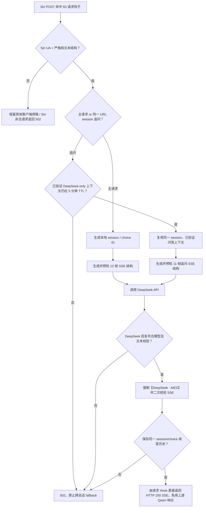

# AIES 63：Siri → DeepSeek v0.7 请求优先实验版（仅本地）

> **2026-11-20 技术预览 / 不取代稳定的 62 LOCAL。** 63 是独立请求侧执行基座，解决 v0.6 `http-request → http-response` 两阶段方案在新连接上偶发丢失 `X-AIES-Request-ID` 而无法安全恢复问题的架构性限制。**CI 能验证协议模拟，不能保证真实 Siri 接受脚本生成的 SSE。**

## 为什么另建 63，而非继续改 62？

10:15 与 10:44 两份 iPad PacketTunnel 的固定码统计表明：

- 已完成多轮 DeepSeek 改写的请求很多，旧版 `previous_choice_id` 缺失可以通过已验证的同一 URL session 历史恢复。
- 未知 `siri.*` 追问组仍被拒，不能仅根据组名前缀盲目放开媒体／工具类请求。
- 部分新 TCP 连接的首个主请求虽然经过 `REQUEST_CAPTURED`，响应阶段却 `RESPONSE_TAG_MISSING`；`req.body` 在响应阶段也无法读取。不应采用“最后一个提问”的全局回退，可能串答、误发隐私。
- 新的请求优先引擎不等待 Qwen 响应，因此不需要跨两个 Shadowrocket hook 的关联 ID；**成功拦截时不向 Qwen 发送该请求**。但前提是脚本 hook 能异步完成且 Siri 接受本地合成的 SSE，这两个行为仍需在真机验证。

## 新执行流程

### 两条严格边界

- **主请求**只接受已知 `siri.multimodal.noRTI` 或 `siri.tqa`/`siri_tqa`，而且请求内容必须是完整的、只包含用户文本消息的已观测形状。未知主请求组返回 502。
- **后续追问**除了已知组，允许仅在**精确 URL session 内存在已验证 DeepSeek 历史**时，将严格 `siri.*` 形式、名称不含明显工具/媒体用途、且正文同样满足已观测纯文本结构的请求识别为 `FOLLOWUP_STRUCTURAL_GROUP_CANDIDATE`。未知组仍可能有其他语义，因此这个模式是隔离的实验版本，不属于 v0.6 稳定白名单。

不采集原始问题、认证头、会话 ID 的实际值到控制台；不会发送 Siri 的 `client_tools/server_tools/response_format/input_hint` 给 DeepSeek。非 Siri 客户端（含 WritingTools）保持旁路，不在 63 中转换。

## 安装与回滚

1. **备份当前 Shadowrocket 配置以及可以工作的 62 JS。**
2. 下载 [v0.7 单文件](../scripts/aies_siri_deepseek_v07_request_first.js)，保存到 iPad「文件 → iCloud 云盘 → Shadowrocket → Script → `aies_siri_deepseek_v07_request_first.js`」，确认文件已下载本机，不带 `.txt`。
3. 在 Shadowrocket 模块中添加 [63 请求优先 LOCAL 模块](../shadowrocket/63-AIES-SIRI-DEEPSEEK-V07-REQUEST-FIRST-LOCAL.sgmodule)，检查**恰好两条 `type=http-request` 规则**、`script-path=Script/aies_siri_deepseek_v07_request_first.js,enable=true`，无 `http-response` 规则。
4. **务必先关闭 60 / 61 / 62 和历史 00 REJECT**；只启用 63，确保 MITM/证书匹配 `prod-yabuli.qianwen.com`。无需更改已在本机配置的 `SAIRS_DEEPSEEK_API_KEY`。
5. 重新应用当前配置／重新连接 VPN 后，先做 **一组不含隐私的主请求加一次追问**。成功时固定日志预期 `[AIES_V07] REQUEST_VALIDATED` → `SYNTHETIC_SSE_PREFLIGHT_PASSED` → `DEEPSEEK_STARTED` → `SIRI_CONTEXT_STORED` → `LOCAL_SSE_RESPONSE_READY`，且 Siri UI **实际显示** `【DeepSeek · AIES】`。
6. 如果出现 Siri“无法从千问获得回答”、会话无法继续、`ERROR_SYNTHETIC_SSE_*` 或 `ERROR_SESSION_STORE_UNAVAILABLE`，**立即停用 63、重新启用原来的 62**。不需要删除 API Key、重装 MITM，亦不需要继续大量提问。

**不要将 60 / 61 / 62 / 63 同时开启。** 尤其不能让请求优先 Hook 与 v0.6 的响应侧 Hook 叠加，否则可能干扰 Siri 响应及来源标记。

## 与 62 的差别及风险

| 属性 | 62 LOCAL（保留） | 63 EXPERIMENTAL（新增） |
|---|---|---|
| HTTP hook | 主/追问共 4 个，请求+响应 | 主/追问共 2 个，仅请求 |
| Qwen 上游是否联系 | 原始请求可能抵达 Qwen | 被成功拦截并本地应答的请求不会由此 Hook 发向 Qwen |
| 对 `X-AIES-Request-ID` 的依赖 | 是，新连接可能丢失 | **否** |
| SSE 来源 | 校验真实 Qwen SSE 骨架后替换文字 | 从已知 SSE 字段结构本地合成 |
| 会话历史 | 已验证同 session DeepSeek-only 文本 | 同样，要求历史和 TTL |
| 对陌生 Siri 组 | 拒绝 | **仅同会话纯文本候选**，仍有兼容风险 |
| 真实 Siri UI | 已经观测有成功，但偶发失败 | **尚未验证，不能宣称提高成功率** |
| 可回滚 | 原样保留 | 关闭 63 并开启 62 即可 |

## 安全与后续验收

v0.7 没有“系统级接管 Siri”的能力：iOS 不经过 MITM、VPN 或拦截 Hook 的流量仍可能走原生 Qwen；来自其他客户端的请求一律旁路。脚本 502 是刻意失败关闭，不代表 DeepSeek 故障。

下一步：先从真机确认 Siri 是否接受本地合成 `session.created` / `session.response.created` 和后续的 continuation URL；检查第二、第三轮是否引用同一会话；再通过非敏感问题进行直问/带千问前缀对照。真实端不通过时回到 62，并改进 v0.7 独立实验分支，不污染生产使用的 62。
